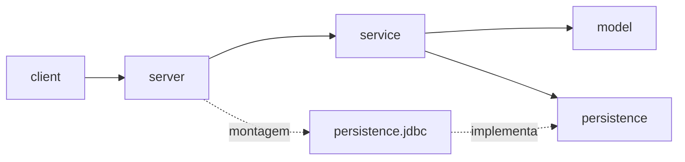
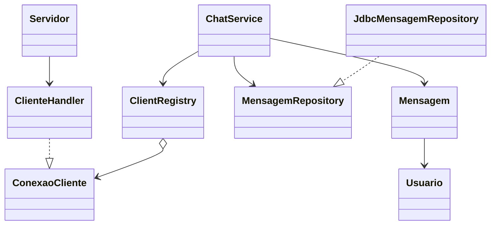
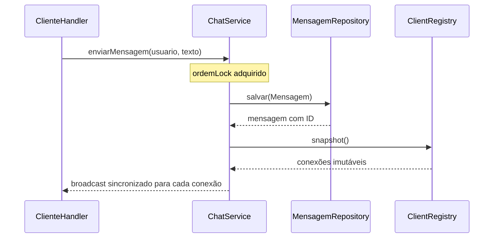

# Relatório final — Chat Multiusuário com Histórico

## Arquitetura

## Fluxo de uma mensagem

## Concorrência e persistência

| Estado compartilhado | Proteção |
|---|---|
| Conexões ativas | `CopyOnWriteArrayList`, operações de nome atômicas e snapshot imutável. |
| Ciclo do servidor | Estado `volatile`, transições sob `cicloLock` e coleção concorrente de handlers. |
| Ordem do serviço | `ordemLock` protege salvar+broadcast e registrar+histórico; clientes lentos reduzem paralelismo. |
| Saída de cada handler | `enviar()` sincronizado; uma linha completa por escrita. |
| Handlers do servidor | Conjunto concorrente; `parar()` fecha servidor e sockets ativos. |
| Socket do cliente de console | A thread de teclado escreve e a receptora lê; fechar o socket encerra as duas direções. |
| JDBC | Uma `Connection` por operação, sempre fechada; `PreparedStatement` e IDs gerados pelo banco. |
| `Usuario` e `Mensagem` | Imutáveis, podem ser compartilhados sem lock. |

Uma race de nick duplicado foi evitada tornando a inclusão atômica (`ClientRegistryTest`). Alterações no registry durante broadcast são seguras por snapshot e foram exercitadas com `ExecutorService` e `CountDownLatch` (`ChatServiceTest`). O lock de ordenação impede que uma mensagem fique entre o registro do novo cliente e o envio do histórico.

O H2 usa `./data/chat`; o schema é inicializado com `CREATE ... IF NOT EXISTS`. O histórico busca os últimos IDs em ordem decrescente e os inverte para a ordem cronológica. Os testes JDBC usam bancos em memória com nome aleatório.

## Escopo, extras e declaração de IA

Os extras não foram implementados. Sugestões para evolução: timeout/heartbeat de inatividade; teste de carga com muitos sockets concorrentes; e teste de reinicialização que demonstre persistência após encerrar o servidor.

IA generativa auxiliou implementação, testes e documentação. O aluno deve revisar e conseguir explicar o código e as decisões; o log está em [docs/RELATORIO_DESENVOLVIMENTO.md](RELATORIO_DESENVOLVIMENTO.md).
